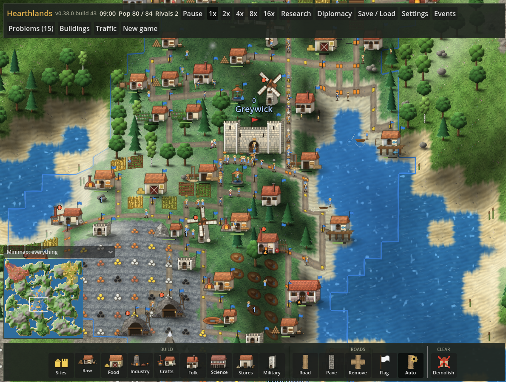
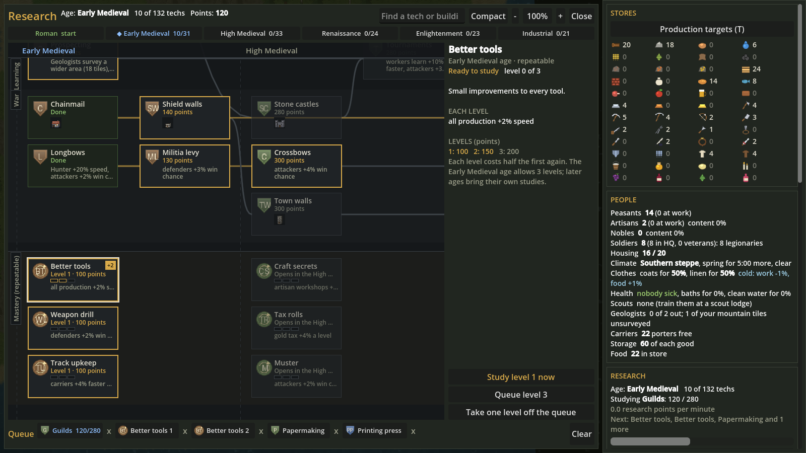

# Hearthlands

A Settlers II style economy and conquest game for **Godot 4.3 or newer**. Build roads, run long
production chains, keep four classes of people fed and content, and push your border out until
every rival headquarters has fallen. Every map is random, and up to 8 AI rivals run the same
economy you do.



## Run it

1. Install Godot 4.3+ (the standard build, not .NET) from godotengine.org.
2. Open Godot, choose **Import**, and select this folder's `project.godot`.
3. Press **F5** (or the play button).

A ready-made Windows build (`Hearthlands.exe`) comes alongside this project. To build it yourself:
**Project > Export**, pick the included **Windows Desktop** preset (Godot offers to download the export
templates the first time), and click **Export Project**. The preset packs everything, including the
`data/*.json` files, into one `.exe`. A **Linux** preset is included too.

From the command line: `godot --headless --export-release "Windows Desktop" ../build/windows/Hearthlands.exe`

## Versions

The current version and build number are on the top bar and the new-game screen, and every save
records the version that made it. `CHANGELOG.md` lists what changed in each build. Before a release,
run `python3 tools/bump_build.py "What changed"` (add `--minor` for new features): it raises the build
number and updates `scripts/version.gd`, `project.godot`, the Windows export settings and the changelog.

## Controls

| Action | Input |
|---|---|
| Pan | Drag with left or middle mouse, or W A S D / arrow keys |
| Zoom | Mouse wheel, + and -, or trackpad pinch |
| Build | Pick a building in the Build panel, click a green tile. Hold Shift to place several |
| Cancel | Right click or Esc |
| Attack | Select one of your military buildings, then click an enemy military building inside the dashed circle. A window shows the defenders, lets you choose how many soldiers march and which kinds, and gives the odds |
| Problems | O, or the Problems button: every building of yours that cannot work and why, longest waiting first, each with Go. Attacks on you blink red on the minimap, stuck buildings amber |
| Production chain | Select a workshop, then Chain: the buildings that make its inputs and use its goods, with rates per minute and the weakest link marked |
| Copy a building | Q over one of your buildings: place another of the same kind, entrance the same way |
| Flags | Toolbar: Flag, then click one of your roads to set or take away a flag (it matters with road carriers: each flag splits a stretch) |
| Expedition | Select a harbour with a free ship: Send an expedition, then click a free coast across the water |
| Garrison | Select one of your military buildings: set how many soldiers it wants (- / + / Full), tick the kinds that may serve there, and choose which kind stays home when it attacks |
| Pause / speed | Space, and 1 to 4 for 1x, 2x, 4x, 8x |
| Minimap | Click or drag to move the camera |
| Research tree | R, or the Research button |
| In the research tree | Drag or the wheel to move, Ctrl + wheel / pinch / + and - to zoom, 0 for the whole tree; click a tech for details, double-click to study it or queue the way to it |
| Diplomacy | G, or the Diplomacy button (it shows how many offers are waiting) |
| Resource info | Click a resource in Stores |
| Deposit info | Click a tree, rock, clay patch, fishing ground or ore vein on the map |
| Toolbar | Along the bottom of the map: the building groups (each opens its buildings above the bar), Road, Pave, Remove road, Auto roads, Demolish, Scout and Geologist. Esc closes a group |
| Building sizes | Small buildings stand on 1 tile, medium on 2 (one behind the other), large on 3 x 2 on fairly flat ground, mines on 1 mountain tile; every building needs a free tile all round. Small and mines can face any side, medium south, east or west, large only south |
| Sites | The Sites button on the toolbar, or B: gold markers on every free spot show the largest building it takes (small house, bigger house, castle, mine sign). Shown also while a building group is open, and, while placing, on every spot that building fits |
| Build | Pick a building from a group on the toolbar. Its entrance (arrow and flag) faces south; R turns it (Shift+R back). With Auto roads off (the default) the road tool then starts at the entrance: click where it should join your roads |
| Roads | Toolbar: Road (click a road, a building or its entrance, then the end; it keeps going from there), Pave, Remove. A road joins a building only at its entrance flag. Auto roads on: new buildings get their road at once |
| Work area | Select a woodcutter, forester, quarry, fisher, clay pit or hunter, then Move work area |
| Priority | Select your building: High, Normal, Low or Paused buttons. Page Up / Page Down raise or lower it, P pauses and resumes |
| Demolish | The Demolish tool on the toolbar, then click your building; or select it and press Demolish or the Delete key. A window lists what you get back and what is lost; Enter demolishes, Esc keeps it. "Don't ask again" (or the option under Textures and mods) turns the question off |
| Production targets | T, the button in Stores, or click a good and use − / + to set how many to keep |
| Settings | Settings button or F10: renderer (OpenGL or Vulkan), display mode, resolution, interface size, VSync, frame-rate limit, animations, sound and volumes, game features |
| Production statistics | F2, or the Statistics button: goods made and used per minute, every realm's growth and a table of where you stand, and Borders: everyone's land minute by minute, to play back (land you have not seen stays dark until the game is over) |
| Event log | E, or the Events button. Drag its title to move it and its edges to resize it. Go on an event moves the camera to where it happened |
| Climate | F4, or the Climate button: seasons, biomes, weather and their effects |
| Random events | F6: switch single events on or off, and see your recent events |
| Send scout | Toolbar: Scout, then click a spot on the map (needs an idle scout from a scout lodge) |
| Send geologist | Toolbar: Geologist, then click a mountain in or near your land |
| Renovate | Select your building once your realm is in a later age: Renovate, or Renovate all of that type |
| Info box | Drag its title to move it; double-click the title to put it back in the corner |
| Performance overlay | F3 |
| Save / load | Save / Load button. F5 quick saves, F9 quick loads |

## How the game works

- **Territory.** You can only build inside your border. Guard huts, towers and castles extend it, but
  only once a soldier moves in. Buildings left outside your border when territory changes burn down.
- **Workers.** Most buildings need a peasant or an artisan. Construction needs an idle peasant as builder.
- **People.**
  - *Peasants* arrive when you have free housing and food in store.
  - *Artisans* are trained at a school (tools and bread) and run mines and workshops.
  - *Nobles* come from a manor and pay gold tax.
  - *Soldiers* come from barracks; armor in store makes them veterans, who win more fights.
- **Contentment.** Artisans want a drink (beer or wine) and clothes. Nobles want wine or beer, clothes,
  jewelry, furniture, and glassware or candles. Content artisans work up to 25% faster, and content
  nobles pay three times the tax.
- **Food.** Everyone eats. Apples, honey, fish, meat, bread, cheese, sausages and smoked fish fill people
  by different amounts. Mines also eat. Without food, production halves and peasants starve.
- **Hills.** Heights shade the map; carriers are slower on steep roads, marked yellow to red as in The Settlers II.
- **Sandbox options.** Start with all research done, or play in creative mode (free, instant building, stores kept half full).
- **A living town.** Close up, townsfolk walk the roads, chat at their doors and play; porters carry crates and sacks, ox carts show their load. Further out the game draws less detail and smaller textures, so it stays fast.
- **Battles in the open.** Columns of realms at war that meet on the march stop and fight: volleys while they close in, then duels with no walls. The winners march on.
- **Dry mines** are demolished 30 s after a warning (40% of their cost back); switch it off in Settings.
- **Stores.** Each resource stops being produced when its store is full, so inputs aren't wasted. Goods on their way (waiting at a building, carried, or being made) count, so a store never holds more than its room; a full good shows amber in the stores list.
- **Combat.** Each duel is close to a coin flip; headquarters and castles defend slightly better, veterans
  tip the odds, and nearby garrisons help defend. Capture a rival's headquarters to eliminate them.
- **Research.** Every realm starts in the Roman age. Scriptoriums, libraries and universities (Science tab)
  turn bread, paper and beer into research points, and nobles add a little. Spend them in the research tree
  on 96 techs across five more ages up to the Industrial Revolution. Techs unlock buildings (pig farms,
  breweries, castles, fortresses, steelworks, textile mills and more) and give bonuses. Research pauses when
  food runs low so your people eat first. With *research victory* on, the first realm to finish the
  Industrial Revolution wins. Rivals research too, each in line with its personality.
- **Roads and carriers.** Every building needs a road to a store. A new building gets a road to the
  network automatically, joining it where the new road plus the walk on to a store is shortest, and you
  can draw, pave or remove roads yourself. Finished goods wait at the
  building until a carrier picks them up: porters (2 goods) come from your stores and your idle peasants,
  mule stations keep 6 mules (3 goods, faster) and ox cart yards 4 carts (6 goods) for buildings within
  their range. Paved roads are walked faster. A building with 6 goods waiting stops until they are collected.
  A spot that no new road could reach (closed in by other buildings, water or rocks) is refused, and the
  site markers leave it out.
- **Road carriers (new-game option).** As in The Settlers: every stretch of road between two flags
  (buildings, junctions, and at least every 6 tiles) has its own carrier, and goods are handed on at the
  flags. A carrier takes one load at a time (a donkey helps on a busy stretch), so on busy roads goods
  wait at the flags; more roads, and more ways out of the headquarters, move more. In a test game realms
  grew 10 to 20% slower than with ordinary porters. Set your own flags (the Flag tool) to split long
  stretches; a donkey farm breeds donkeys, and each donkey in store helps on one busy stretch. Rivals set
  flags on their jammed stretches.
- **Stores.** There is no shared stock: every store keeps its own goods. Headquarters hold 60 of each good,
  a storehouse 40, a warehouse 120 and a great depot 300 (bulky goods like bricks and gold take more room).
  Goods made are carried to the nearest store (on to the next one with room if it is full); production
  pauses when the realm has no room left. The Stores panel shows the total of all stores; click a store to
  see what it holds. Losing a store moves its goods to your other stores, as far as they have room.
  With more than one store, each can be set to *Normal* (passes on what it has too much of), *Gather here*
  (other stores send it their goods) or *Send away* (takes nothing new, its goods go to the others).
- **Carried inputs.** A workshop, mine or school works only with goods carried to it: a carrier fetches
  them from the nearest store by road that has them, and each keeps enough for two work cycles (food for
  one); its info box can change that to 1 or 4. A carrier with room left takes a second input the same
  building is short of. Construction materials come the same way. Its info box shows what is there, what is
  on its way, and who is walking there and how soon they arrive.
- **People live in buildings.** Idle people wait in houses and apartments (newcomers), at the building that
  trained them (artisans at the school, soldiers at the barracks, scouts at the scout lodge), in workers'
  lodges (12 each, Folk group) or at headquarters. A new worker, builder or soldier walks along the roads
  from the nearest of these that has one; a building starts work when he arrives. A new military building
  claims its land when its first soldier walks in.
- **Work areas.** Gatherers (woodcutter, forester, quarry, fisher, clay pit, hunter) can move their work
  area up to 6 tiles from the building, for example to reach a forest beyond a lake. Walking there and back
  adds time to every cycle.
- **Ore veins.** Touching ore tiles of one kind form a vein with a random amount: most are modest, a few
  are very rich. A mine on any tile of a vein draws from the whole vein, and the vein vanishes when it is
  empty. Click a deposit to see how much is left.
- **Trades and specialists.** Every working building belongs to a trade: woodland, mining and quarrying,
  farming, fishing and hunting, food and drink, woodwork, metalwork, kilns and glass, textiles and leather,
  fine crafts, teaching and learning, or transport. Workers gain experience with each finished work cycle,
  but only in their own trade, and level up from 1 to 5, working 10% faster per level. From level 3 a worker
  is a specialist (a woodsman, miner, smith, joiner...) and at level 5 a master. A worker who leaves a
  building (demolished, or not enough workers to go round) keeps his skill and waits among the idle
  workers; the next building of the same trade hires him first. Put him in another trade and he starts
  again at level 1: when there are more idle specialists than idle workers, the least skilled lose their
  specialty first. The People panel shows each trade's workers and average level.
- **Priorities.** Every working building and construction site has a priority. *High*: it gets workers
  and builders first, carriers fetch its goods first, and it checks for missing goods every half second.
  *Low*: it gets workers last and leaves the last 6 of each input (12 food) for other buildings. *Paused*:
  it stops, and its worker or builder goes back to the idle workers (keeping his skill). A small arrow or
  pause sign on the map marks buildings that aren't on normal priority.
- **Tools.** Each trade has its own tool (axes for woodland, pickaxes for mining, farm tools, bows and rods,
  knives, saws, smith's tongs, trowels, shears, chisels, quills, harnesses). A building taking on a new
  worker needs one from the stores; an idle specialist of its trade brings his own. The toolsmith makes the
  tool most wanted: first those buildings are waiting for, then those below their production target (2 of
  each by default). The toolsmith needs no tool himself, so you can always recover.
- **Production targets.** For any good, set how many to keep in store; buildings making it pause at that
  number and start again below it (Production targets window, T).
- **Difficulty.** On the new-game screen: a preset (Easy, Normal, Hard, Custom), starting goods, peace at
  the start, research and construction speed, endless ore veins, endless stone, clay and fish, and whether
  new workers need tools.
- **Soldiers' experience.** Soldiers gain experience by winning duels; each level is worth 3% in every duel.
- **Diplomacy.** Every realm starts at war. Offer peace, propose alliances, declare war, trade or give
  gifts in the Diplomacy window. Each rival has an opinion of you that rises with gifts, fair trades, peace
  and shared enemies and falls when you attack or break treaties. Peace stops attacks both ways; allies'
  garrisons help defend each other. Rivals make offers to you and treaties with each other. Once at least
  half the rivals are defeated, an alliance with everyone left is an allied victory, and an ally reaching
  the Industrial Revolution counts as a shared victory.
- **Building sites.** *Bell when done* in a site's info box plays a sound and says so when it is finished.
  While placing a military building, the spots that would claim the most new land show "+N".
- **Saving.** Name a save, or use F5/F9 for a quick slot. The game autosaves every 5 minutes of play.
  The save list shows a small picture of each map.
  Saves are complete: loading continues the game exactly where it was, including rival plans and armies on the march.
  They live in `user://saves` next to the texture folder.
- **Missions.** The Missions button on the new-game screen: four games with goals (build, grow, arm,
  study, conquer) and a deadline. The third plays on a hand-made map. Goals show in the box on the left.
  More can be added in `data/missions.json` (or a mod's).
- **Map editor.** The Map editor button on the new-game screen opens the map of the seed and size chosen
  there, empty. Paint water, beach, grass, mountain, trees, rocks, clay and ore with a brush (1 to 9
  tiles), move the numbered start places (start 1 is yours), name the map and Save it, or Play it. Saved
  maps can be picked under Map on the new-game screen; they are kept in the `maps` folder of the game's
  data folder.
- **Ships and harbours.** A harbour (on the coast) is a store that holds a little land, a soldier and 8
  people. A shipyard builds a ship from 4 planks, up to 6. From a harbour an expedition (a ship, 4 planks,
  2 stone and a soldier) sails to a free coast and founds a new harbour there with land around it. Ships
  then carry goods between your harbours that no road joins, from where there is plenty to where there is
  little. Crowded rivals sail too.
- **Catapults.** A catapult near the border throws a stone at an enemy military building in range every
  work cycle; a hit may kill a defender.
- **Map size.** Auto fits the number of realms, or choose Small (96), Medium (128), Large (160), Huge (200)
  or Giant (256 tiles a side). Small maps with many realms are refused before generating.
- **Rivals.** Strength 1 to 10 sets how fast they produce and decide, their starting stock, how soon they
  attack and what odds they accept. Each is a *builder*, *balanced* or *warlord* personality, and they
  fight each other as well as you. They keep large spots free for farms, group workshops near their
  suppliers, choose targets worth taking (headquarters, much land, mines), keep a guard home, and call an
  attack back when it goes badly.

## Graphics settings

Open **Settings** (top bar or F10). Everything there is remembered in `user://settings.cfg`.

- **Renderer.** *Vulkan (Forward+)* is preferred. *OpenGL (Compatibility)* needs only OpenGL 3.3, which
  almost every PC has, and is what the engine starts with. On the first start the game tests Vulkan once,
  in a small extra window that closes by itself; if it works, the game restarts with Vulkan and keeps it,
  if not it stays on OpenGL and does not test again. *Vulkan (Mobile)* is a lighter Vulkan renderer.
  Godot picks its renderer before the game starts, so switching restarts the game; it autosaves first
  and carries on afterwards. A new renderer is tried once and kept only if it starts, so a PC without
  Vulkan always comes back on OpenGL. The choice is stored in `user://graphics_override.cfg`.
  For a 2D game like this one, OpenGL is usually just as fast; the drawing itself is the main cost, and
  any graphics card does it far faster than a computer without one (see `tools/render_bench.gd`).
- **Display and resolution.** Window, borderless fullscreen or exclusive fullscreen. In a window the
  resolution is the window size. In fullscreen, *Native* draws at the screen's own size; a lower resolution
  draws fewer pixels and stretches them to fill the screen: faster on a weak graphics card, but softer.
- **Interface size** scales everything, **VSync** waits for the screen (no tearing), and the **frame-rate
  limit** saves power.
- **Ground details** (on by default): grass tufts, flowers, pebbles, reeds, shore foam and snow on high
  peaks. **Day and night** (off by default): a slow day, dark nights with lit windows; only the look changes.
- **Raised ground** (on by default) draws hills standing up from the map, as in The Settlers II (2.5D).
  Off gives the flat map of earlier builds.
- **Language**: English or German (Deutsch) for the interface. Messages from the game itself (the event
  log and the building info) are still in English. Other languages: add `data/lang_<code>.json` (or put
  it in the mods folder's `data`); `python3 tools/extract_strings.py` fills in the texts to translate.
- **Keys**: click a key in the list, then press the new one (Esc keeps the old one). *Default keys* puts
  them all back.
- **Show the first-game guide**: a short checklist for the first minutes of a new game, ticked off as you
  go. Closing it turns this off.
- Command line (also for the exported game): `--rendering-method gl_compatibility` or `forward_plus` or
  `mobile` starts with that renderer once; `--resolution 1280x720` sets the window size.

## Resources (60)

Logs, Stone, Clay, Water, Grain, Hops, Wool, Hides, Salt, Coal, Iron ore, Copper ore, Gold ore, Planks, Bricks, Flour, Bread, Fish, Smoked fish, Meat, Apples, Beer, Cloth, Leather, Paper, Iron, Copper, Gold, Axes, Pickaxes, Farm tools, Bows and rods, Knives, Saws, Smith's tongs, Trowels, Shears, Chisels, Quills, Harnesses, Weapons, Armor, Clothes, Flax, Linen clothes, Fur coats, Jewelry, Furniture, Sand, Glassware, Milk, Cheese, Sausages, Honey, Beeswax, Candles, Grapes, Wine, Herbs, Medicine.

Food (everyone eats it, cheapest first): Bread, Fish, Smoked fish, Meat, Apples, Cheese, Sausages, Honey.

## Buildings (81 you can build)

**Raw**

| Building | Cost | Worker (trade) | Uses | Makes | Research |
|---|---|---|---|---|---|
| Woodcutter | 2 planks | peasant (woodland) | – | 1 logs | Roman (start) |
| Forester | 2 planks | peasant (woodland) | – | – | Roman (start) |
| Quarry | 2 planks | peasant (mining and quarrying) | – | 1 stone | Roman (start) |
| Sawmill | 2 planks, 1 stone | peasant (woodwork) | 1 logs | 1 planks | Roman (start) |
| Clay pit | 2 planks | peasant (mining and quarrying) | – | 1 clay | Roman (start) |
| Charcoal burner | 3 planks, 1 stone | peasant (woodland) | 2 logs | 1 coal | Roman (start) |
| Saltworks | 3 planks, 1 stone | peasant (mining and quarrying) | – | 1 salt | Salt roads |
| Flax farm | 3 planks | peasant (farming) | – | 2 flax | Roman (start) |
| Sand pit | 2 planks | peasant (mining and quarrying) | – | 1 sand | Guilds |

**Food**

| Building | Cost | Worker (trade) | Uses | Makes | Research |
|---|---|---|---|---|---|
| Fisher | 2 planks | peasant (fishing and hunting) | – | 1 fish | Roman (start) |
| Hunter | 2 planks | peasant (fishing and hunting) | – | 1 meat, 1 hides | Roman (start) |
| Farm | 3 planks, 1 stone | peasant (farming) | – | 3 grain | Roman (start) |
| Orchard | 3 planks | peasant (farming) | – | 3 apples | Roman (start) |
| Hop farm | 3 planks, 1 stone | peasant (farming) | – | 2 hops | Monasteries |
| Sheep farm | 3 planks, 1 stone | peasant (farming) | 1 water | 2 wool | Wool trade |
| Pig farm | 4 planks, 2 stone | peasant (farming) | 1 grain, 1 water | 3 meat, 1 hides | Heavy plough |
| Well | 2 planks, 1 stone | peasant (farming) | – | 1 water | Roman (start) |
| Mill | 3 planks, 2 stone | peasant (food and drink) | 1 grain | 1 flour | Roman (start) |
| Bakery | 3 planks, 2 stone | peasant (food and drink) | 1 flour, 1 water | 3 bread | Roman (start) |
| Smokehouse | 3 planks, 2 stone | peasant (food and drink) | 2 fish, 1 salt, 1 logs | 3 smoked fish | Salt roads |
| Brewery | 4 planks, 3 stone | artisan (food and drink) | 1 grain, 1 hops, 1 water | 2 beer | Monasteries |
| Apiary | 3 planks | peasant (woodland) | – | 1 honey, 1 beeswax | Roman (start) |
| Dairy farm | 3 planks, 1 stone | peasant (farming) | 1 grain, 1 water | 2 milk | Heavy plough |
| Cheesery | 3 planks, 2 stone | peasant (food and drink) | 2 milk, 1 salt | 3 cheese | Salt roads |
| Butcher | 3 planks, 2 stone | peasant (food and drink) | 2 meat, 1 salt | 4 sausages | Salt roads |
| Vineyard | 3 planks, 1 stone | peasant (farming) | – | 2 grapes | Monasteries |
| Winery | 4 planks, 3 stone | artisan (food and drink) | 2 grapes | 2 wine | Monasteries |

**Industry**

| Building | Cost | Worker (trade) | Uses | Makes | Research |
|---|---|---|---|---|---|
| Coal mine | 4 planks, 2 stone | artisan (mining and quarrying) | 1 food | 1 coal | Roman (start) |
| Iron mine | 4 planks, 2 stone | artisan (mining and quarrying) | 1 food | 1 iron ore | Roman (start) |
| Gold mine | 4 planks, 2 stone | artisan (mining and quarrying) | 1 food | 1 gold ore | Roman (start) |
| Copper mine | 4 planks, 2 stone | artisan (mining and quarrying) | 1 food | 1 copper ore | Roman (start) |
| Brickworks | 3 planks, 2 stone | peasant (kilns and glass) | 2 clay, 1 coal | 2 bricks | Roman (start) |
| Iron smelter | 3 planks, 3 stone | artisan (metalwork) | 1 iron ore, 1 coal | 1 iron | Roman (start) |
| Copper smelter | 3 planks, 3 stone | artisan (metalwork) | 1 copper ore, 1 coal | 1 copper | Roman (start) |
| Mint | 3 planks, 3 stone | artisan (metalwork) | 1 gold ore, 1 coal | 1 gold | Roman (start) |
| Steelworks | 6 planks, 8 bricks, 4 iron | artisan (metalwork) | 2 iron ore, 1 coal | 3 iron | Steam engine |
| Glassworks | 3 planks, 3 stone, 2 bricks | artisan (kilns and glass) | 2 sand, 1 coal | 1 glassware | Guilds |

**Crafts**

| Building | Cost | Worker (trade) | Uses | Makes | Research |
|---|---|---|---|---|---|
| Toolsmith | 3 planks, 3 stone | artisan (metalwork) | 1 iron, 1 planks | 2 tools, the kind most wanted | Roman (start) |
| Weaponsmith | 3 planks, 3 stone | artisan (metalwork) | 1 iron, 1 coal | 1 weapons | Roman (start) |
| Armorer | 3 planks, 3 stone | artisan (metalwork) | 1 iron, 1 leather, 1 coal | 1 armor | Chainmail |
| Tannery | 3 planks, 2 stone | artisan (textiles and leather) | 1 hides, 1 water | 1 leather | Roman (start) |
| Weaver | 3 planks, 2 stone | peasant (textiles and leather) | 2 wool | 1 cloth | Wool trade |
| Tailor | 3 planks, 2 stone | artisan (textiles and leather) | 2 cloth | 1 clothes | Guilds |
| Linen weaver | 3 planks, 1 stone | peasant (textiles and leather) | 2 flax | 2 linen clothes | Roman (start) |
| Furrier | 3 planks, 1 stone | peasant (textiles and leather) | 2 hides | 2 fur coats | Roman (start) |
| Jeweller | 3 planks, 3 stone, 2 bricks | artisan (fine crafts) | 1 gold, 1 copper | 1 jewelry | Guilds |
| Carpenter | 3 planks, 2 stone | artisan (woodwork) | 2 planks | 1 furniture | Guilds |
| Machine works | 5 planks, 6 bricks, 3 iron | artisan (metalwork) | 1 iron, 1 coal | 3 tools, the kind most wanted, 1 weapons | Steam engine |
| Textile mill | 5 planks, 6 bricks, 2 iron | peasant (textiles and leather) | 2 wool, 1 coal | 3 cloth, 1 clothes | Textile mills |
| Chandler | 3 planks, 1 stone | artisan (fine crafts) | 1 beeswax | 2 candles | Monasteries |

**Folk**

| Building | Cost | Worker (trade) | Uses | Makes | Research |
|---|---|---|---|---|---|
| House | 2 planks, 1 stone | – | – | houses 8 | Roman (start) |
| Workers' lodge | 3 planks, 1 stone | – | – | – | Roman (start) |
| Apartments | 4 planks, 3 stone, 3 bricks | – | – | houses 20 | Roman (start) |
| School | 4 planks, 3 stone | peasant (teaching and learning) | 2 bread | trains an artisan | Roman (start) |
| Barracks | 4 planks, 4 stone | artisan (teaching and learning) | 1 weapons, 1 bread | trains a soldier | Roman (start) |
| Manor | 6 planks, 4 stone, 4 bricks, 3 gold | artisan (teaching and learning) | 2 gold, 1 bread | trains a noble | Feudalism |
| Herb garden | 2 planks | peasant (farming) | – | 2 herbs | Roman (start) |
| Apothecary | 3 planks, 2 stone | artisan (healing) | 2 herbs | 2 medicine | Roman (start) |
| Infirmary | 4 planks, 3 stone | artisan (healing) | 1 medicine | – | Roman (start) |
| Bathhouse | 4 planks, 3 stone | peasant (healing) | 1 water, 1 logs | – | Roman (start) |

**Science**

| Building | Cost | Worker (trade) | Uses | Makes | Research |
|---|---|---|---|---|---|
| Scriptorium | 3 planks, 2 stone | artisan (teaching and learning) | 1 bread | 4 research | Roman (start) |
| Library | 4 planks, 4 stone | artisan (teaching and learning) | 1 bread | 8 research | Monasteries |
| Paper mill | 3 planks, 2 stone | peasant (woodwork) | 1 logs, 1 water | 2 paper | Papermaking |
| University | 6 planks, 6 stone, 6 bricks | artisan (teaching and learning) | 1 paper, 1 beer | 16 research | Printing press |

**Roads & stores**

| Building | Cost | Worker (trade) | Uses | Makes | Research |
|---|---|---|---|---|---|
| Storehouse | 4 planks, 2 stone | – | – | room for 40 of each good, 8 porters | Roman (start) |
| Warehouse | 6 planks, 6 stone, 4 bricks | – | – | room for 120 of each good, 12 porters | Trade fairs |
| Great depot | 8 planks, 10 bricks, 4 iron | – | – | room for 300 of each good, 20 porters | Railways |
| Mule station | 3 planks, 1 stone | peasant (transport) | 1 grain | 6 mules carrying 3 within 10 tiles | Roman (start) |
| Ox cart yard | 5 planks, 2 stone | artisan (transport) | 1 planks | 4 carts carrying 6 within 12 tiles | Ox carts |

**Military**

| Building | Cost | Worker (trade) | Uses | Makes | Research |
|---|---|---|---|---|---|
| Palisade | 3 planks | – | – | claims 5 tiles, holds 1 | Roman (start) |
| Guard hut | 2 planks, 1 stone | – | – | claims 6 tiles, holds 2 | Roman (start) |
| Guardhouse | 2 planks, 3 stone | – | – | claims 7 tiles, holds 3, walls +3% | Shield walls |
| Tower | 3 planks, 4 stone | – | – | claims 9 tiles, holds 4 | Roman (start) |
| Keep | 4 planks, 6 stone | – | – | claims 11 tiles, holds 6, walls +5% | Town walls |
| Castle | 5 planks, 6 stone, 4 bricks, 2 gold | – | – | claims 13 tiles, holds 8 | Stone castles |
| Scout lodge | 3 planks, 1 stone | peasant (fishing and hunting) | 1 bread, 1 bows and rods | trains a scout | Roman (start) |
| Watch tower | 3 planks, 2 stone | scout (mil) | – | – | Roman (start) |
| Fortress | 6 planks, 10 stone, 8 bricks, 2 iron | – | – | claims 15 tiles, holds 12 | Gunpowder |
| Star fort | 4 planks, 10 stone, 6 bricks | – | – | claims 14 tiles, holds 10, walls +8%, 2 cannon (range 7) | Star forts |
| Gun battery | 3 planks, 4 stone, 3 iron | – | – | claims 8 tiles, holds 5, 3 cannon (range 8) | Drill manuals |
| Armoured redoubt | 3 planks, 8 stone, 10 bricks, 6 iron | – | – | claims 16 tiles, holds 16, walls +8%, 4 cannon (range 9) | Rifling |

## Research tree



| Age | Tech | Cost | Requires | Unlocks | Effect |
|---|---|---|---|---|---|
| Early Medieval | Iron axes | 110 | – | – | Woodcutter +20% speed |
| Early Medieval | Coppicing | 110 | – | – | Forester +30% speed |
| Early Medieval | Fish traps | 110 | – | – | Fisher +20% speed |
| Early Medieval | Wells and cisterns | 110 | – | – | Well +30% speed |
| Early Medieval | Heavy plough | 120 | – | Pig farm, Dairy farm | Farm +25% speed |
| Early Medieval | Watermills | 120 | – | – | Mill +50% speed, Sawmill +50% speed |
| Early Medieval | Stone masonry | 120 | – | – | Quarry +20% speed |
| Early Medieval | Beekeeping | 120 | – | – | Apiary +30% speed |
| Early Medieval | Tool care | 120 | – | – | 15% of new workers need no new tool |
| Early Medieval | Longbows | 130 | – | – | Hunter +20% speed, attack odds +2% |
| Early Medieval | Granaries | 130 | – | – | store room +10% |
| Early Medieval | Timber framing | 130 | – | – | build speed +10%, housing +10% |
| Early Medieval | Herbal lore | 130 | Monasteries | – | people eat -5% |
| Early Medieval | Village markets | 130 | – | – | carrier speed +5%, gold tax +5% |
| Early Medieval | Monasteries | 140 | – | Hop farm, Brewery, Library, Vineyard, Winery, Chandler | – |
| Early Medieval | Chainmail | 140 | – | Armorer | defence odds +3% |
| Early Medieval | Ox carts | 140 | – | Ox cart yard | – |
| Early Medieval | Horse collar | 140 | Heavy plough | – | carrier speed +10% |
| Early Medieval | Apprenticeship | 140 | – | – | workers learn +15% faster |
| Early Medieval | Bellows | 140 | – | – | metalwork workers +10% speed |
| Early Medieval | Shield walls | 140 | Chainmail | – | defence odds +3% |
| Early Medieval | Open-field farming | 150 | Heavy plough | – | Farm +15% speed |
| Early Medieval | Tithes | 150 | Monasteries | – | gold tax +10%, research +5% |
| Early Medieval | Feudalism | 160 | – | Manor | gold tax +25% |
| Early Medieval | Prospecting | 120 | – | – | – |
| Early Medieval | Charcoal clamps | 120 | – | – | Charcoal burner +25% speed |
| Early Medieval | Clay working | 120 | – | – | Clay pit +25% speed, Brickworks +10% speed |
| Early Medieval | Hunting dogs | 120 | – | – | Hunter +25% speed |
| Early Medieval | Village smithy | 140 | Bellows | – | Toolsmith +20% speed, Weaponsmith +10% speed |
| Early Medieval | Militia levy | 130 | Longbows | – | defence odds +3% |
| Early Medieval | Pack mules | 130 | Ox carts | – | carrier speed +10% |
| High Medieval | Wool trade | 240 | Heavy plough | Sheep farm, Weaver | – |
| High Medieval | Salt roads | 240 | – | Saltworks, Smokehouse, Cheesery, Butcher | carrier speed +10% |
| High Medieval | Post windmills | 240 | Watermills | – | Mill +30% speed |
| High Medieval | Cheesemaking | 240 | Heavy plough | – | Cheesery +30% speed, Dairy farm +20% speed |
| High Medieval | Bark tanning | 240 | Coppicing | – | Tannery +30% speed |
| High Medieval | Trade fairs | 260 | Ox carts | Warehouse | carrier speed +10% |
| High Medieval | Three-field system | 260 | Open-field farming | – | farming workers +15% speed |
| High Medieval | Heavy horses | 260 | Horse collar | – | carrier speed +15% |
| High Medieval | Wool combing | 260 | Heavy plough | – | textiles and leather workers +15% speed |
| High Medieval | Dyeing | 260 | Monasteries | – | Tailor +25% speed |
| High Medieval | Brewers' guild | 260 | Monasteries | – | Brewery +30% speed |
| High Medieval | Vintners | 260 | Monasteries | – | Vineyard +25% speed, Winery +25% speed |
| High Medieval | Hospices | 260 | Herbal lore | – | newcomers arrive +25% faster |
| High Medieval | Cellars | 260 | Granaries | – | store room +15% |
| High Medieval | Stone castles | 280 | Feudalism | Castle | defence odds +3% |
| High Medieval | Guilds | 280 | Monasteries | Tailor, Carpenter, Jeweller, Sand pit, Glassworks | artisan workshops +10% |
| High Medieval | Cathedral schools | 280 | Monasteries | – | School +30% speed, research +5% |
| High Medieval | Town charters | 280 | Feudalism | – | gold tax +15% |
| High Medieval | Stone roads | 280 | Stone masonry | – | carrier speed +10% |
| High Medieval | Journeymen | 280 | Apprenticeship | – | workers learn +20% faster |
| High Medieval | Papermaking | 300 | Monasteries | Paper mill | research +15% |
| High Medieval | Crossbows | 300 | Longbows | – | attack odds +4% |
| High Medieval | Masons' guild | 300 | Stone masonry | – | build speed +15%, mining and quarrying workers +10% speed |
| High Medieval | Town walls | 300 | Shield walls | – | defence odds +4% |
| High Medieval | Smoke curing | 250 | Salt roads | – | Smokehouse +30% speed, Butcher +20% speed |
| High Medieval | Candle making | 250 | Monasteries | – | Chandler +30% speed |
| High Medieval | Tanners' guild | 270 | Bark tanning | – | Tannery +25% speed, Furrier +20% speed |
| High Medieval | Herbals | 270 | Hospices, Papermaking | – | Apothecary +30% speed, Herb garden +20% speed |
| High Medieval | Glassblowing | 280 | Guilds | – | Glassworks +30% speed, Sand pit +20% speed |
| High Medieval | Fulling mills | 280 | Wool combing, Watermills | – | Weaver +25% speed |
| High Medieval | Tournaments | 280 | Stone castles | – | workers learn +10% faster, attack odds +3% |
| High Medieval | Treadwheel cranes | 290 | Masons' guild | – | build speed +15% |
| High Medieval | Stone bridges | 290 | Stone roads | – | carrier speed +15% |
| Renaissance | Cartography | 440 | Salt roads | – | carrier speed +25%, build speed +15% |
| Renaissance | Printing press | 480 | Papermaking | University | research +25% |
| Renaissance | Banking | 480 | Guilds | – | gold tax +50%, Mint +50% speed |
| Renaissance | Lens grinding | 480 | Guilds | – | Glassworks +40% speed, research +5% |
| Renaissance | Engraving | 480 | Guilds | – | Jeweller +30% speed, Mint +20% speed |
| Renaissance | Standard tool patterns | 480 | Tool care | – | Toolsmith +50% speed, 10% of new workers need no new tool |
| Renaissance | Double-entry bookkeeping | 500 | Town charters | – | gold tax +20% |
| Renaissance | Humanism | 500 | Cathedral schools | – | research +10%, artisans and nobles use -10% goods |
| Renaissance | New World crops | 500 | Three-field system | – | people eat -10% |
| Renaissance | Mine pumps | 520 | Masons' guild | – | mining and quarrying workers +20% speed |
| Renaissance | Guild halls | 520 | Journeymen | – | artisan workshops +10%, workers learn +15% faster |
| Renaissance | Vein surveying | 540 | Masons' guild | – | 25% of mining leaves the vein untouched |
| Renaissance | Joint-stock companies | 540 | Village markets | – | carrier speed +15%, store room +15% |
| Renaissance | Gunpowder | 560 | Stone castles, Chainmail | Fortress | attack odds +5% |
| Renaissance | Musketry | 560 | Crossbows | – | attack odds +5% |
| Renaissance | Star forts | 560 | Town walls | – | defence odds +6% |
| Renaissance | Geological survey | 480 | Prospecting | – | – |
| Renaissance | Distilling | 480 | Brewers' guild | – | Brewery +20% speed, Winery +20% speed |
| Renaissance | Trip hammers | 500 | Village smithy, Guilds | – | metalwork workers +20% speed |
| Renaissance | Milled coinage | 500 | Banking | – | Mint +30% speed, gold tax +5% |
| Renaissance | Navigators' school | 520 | Cartography | – | Fisher +20% speed, research +3% |
| Renaissance | Hospitals | 520 | Hospices | – | Infirmary +30% speed |
| Renaissance | Clockmaking | 540 | Lens grinding | – | all production +3% |
| Renaissance | Field artillery | 580 | Gunpowder | – | attack odds +5% |
| Enlightenment | Crop rotation | 720 | Wool trade | – | Farm +50% speed, Orchard +50% speed, Hop farm +30% speed |
| Enlightenment | Selective breeding | 740 | Cheesemaking | – | Sheep farm +40% speed, Pig farm +40% speed, Dairy farm +40% speed |
| Enlightenment | Lubricants | 740 | Standard tool patterns | – | 15% of new workers need no new tool, transport workers +30% speed |
| Enlightenment | Blast furnace | 760 | Guilds | – | Iron smelter +1 output, Copper smelter +1 output |
| Enlightenment | Seed drill | 760 | Three-field system | – | farming workers +25% speed |
| Enlightenment | Inoculation | 760 | Hospices | – | newcomers arrive +30% faster, people eat -5% |
| Enlightenment | Flying shuttle | 760 | Wool combing | – | Weaver +50% speed |
| Enlightenment | Porcelain | 760 | Lens grinding | – | kilns and glass workers +30% speed |
| Enlightenment | Town planning | 780 | Timber framing | – | housing +20%, build speed +15% |
| Enlightenment | Scientific method | 800 | Printing press | – | research +50% |
| Enlightenment | Standing army | 800 | Gunpowder | – | Barracks +50% speed, attack odds +5%, defence odds +5% |
| Enlightenment | Canals | 800 | Joint-stock companies | – | carrier speed +25% |
| Enlightenment | Coke smelting | 800 | Mine pumps | – | metalwork workers +20% speed |
| Enlightenment | Drill manuals | 800 | Musketry | – | Barracks +30% speed, defence odds +4% |
| Enlightenment | The Encyclopedia | 820 | Humanism | – | research +20% |
| Enlightenment | Bank notes | 820 | Double-entry bookkeeping | – | gold tax +25% |
| Enlightenment | Agricultural societies | 760 | Crop rotation | – | farming workers +15% speed |
| Enlightenment | Sewers | 780 | Town planning | – | housing +10%, Bathhouse +30% speed |
| Enlightenment | Turnpike roads | 780 | Canals | – | carrier speed +15% |
| Enlightenment | Chemistry | 800 | Scientific method | – | Brickworks +20% speed, Glassworks +20% speed, Tannery +15% speed |
| Enlightenment | Bayonets | 800 | Drill manuals | – | attack odds +4%, defence odds +4% |
| Enlightenment | Insurance | 800 | Bank notes | – | gold tax +10%, newcomers arrive +10% faster |
| Enlightenment | Royal academies | 820 | The Encyclopedia | – | research +15% |
| Industrial | Textile mills | 1040 | Steam engine, Crop rotation | Textile mill | – |
| Industrial | Canning | 1060 | New World crops | – | people eat -10% |
| Industrial | Gas lighting | 1080 | Scientific method | – | all production +5%, artisans and nobles use -10% goods |
| Industrial | Power loom | 1100 | Steam engine | – | textiles and leather workers +40% speed |
| Industrial | Iron ships | 1100 | Coke smelting | – | Fisher +40% speed, carrier speed +10% |
| Industrial | Steel ploughs | 1100 | Seed drill | – | farming workers +30% speed |
| Industrial | Steam engine | 1120 | Scientific method, Blast furnace | Steelworks, Machine works | industry buildings +20% speed, crafts buildings +20% speed |
| Industrial | Mass schooling | 1120 | The Encyclopedia | – | School +50% speed, workers learn +20% faster |
| Industrial | Public health | 1120 | Inoculation | – | newcomers arrive +40% faster, housing +15% |
| Industrial | Steam pumps | 1140 | Steam engine | – | mining and quarrying workers +30% speed, 25% of mining leaves the vein untouched |
| Industrial | Portland cement | 1140 | Town planning | – | build speed +30%, store room +20% |
| Industrial | Machine tools | 1160 | Steam engine | – | Toolsmith +1 output, Machine works +30% speed |
| Industrial | Rifling | 1160 | Drill manuals | – | attack odds +6% |
| Industrial | Telegraph | 1180 | The Encyclopedia | – | research +15%, carrier speed +10% |
| Industrial | Railways | 1200 | Steam engine | Great depot | carrier speed +60%, build speed +40% |
| Industrial | Industrial Revolution | 2400 | Railways, Textile mills, Standing army | – | all production +25% |
| Industrial | Tenements | 1080 | Portland cement | – | housing +15% |
| Industrial | Steam trawlers | 1080 | Iron ships | – | Fisher +40% speed |
| Industrial | Blasting powder | 1100 | Steam pumps | – | mining and quarrying workers +20% speed |
| Industrial | Rotary press | 1100 | Telegraph | – | research +15% |
| Industrial | Breech-loaders | 1180 | Rifling | – | attack odds +6% |

### Mastery: repeatable studies

Each age has its own; they open when the realm enters that age. Each level costs half the first again.

| Age | Study | First level | Levels | Each level |
|---|---|---|---|---|
| Early Medieval | Better tools | 100 | 3 | all production +2% |
| Early Medieval | Weapon drill | 100 | 3 | defence odds +2% |
| Early Medieval | Track upkeep | 100 | 3 | carrier speed +4% |
| High Medieval | Craft secrets | 200 | 3 | artisan workshops +3% |
| High Medieval | Tax rolls | 200 | 3 | gold tax +4% |
| High Medieval | Muster | 200 | 3 | attack odds +2% |
| Renaissance | Workshop practice | 380 | 4 | all production +2% |
| Renaissance | Scholarship | 380 | 4 | research +4% |
| Renaissance | Veteran training | 380 | 4 | workers learn +5% faster |
| Enlightenment | Method | 600 | 4 | all production +2% |
| Enlightenment | Logistics | 600 | 4 | carrier speed +4%, build speed +3% |
| Enlightenment | Fortification | 600 | 4 | defence odds +2% |
| Industrial | Mass production | 900 | 5 | all production +2% |
| Industrial | Statistics | 900 | 5 | research +3%, gold tax +3% |
| Industrial | General staff | 900 | 5 | attack odds +2%, defence odds +2% |

## Custom textures

Every picture in the game can be replaced without touching the project.

1. In game, open **Textures and mods** in the side panel and click **Export defaults**. This writes
   every texture the game uses, plus `TEXTURES.txt` listing them, into your texture folder.
2. Click **Open texture folder**, edit or replace any PNG (keep the file name), then click **Reload textures**.
3. **Browse textures** shows every texture, its name and which ones are custom.

Texture folder (Godot's `user://textures`):

| OS | Path |
|---|---|
| Windows | `%APPDATA%\Godot\app_userdata\Hearthlands\textures` |
| macOS | `~/Library/Application Support/Godot/app_userdata/Hearthlands/textures` |
| Linux | `~/.local/share/godot/app_userdata/Hearthlands/textures` |

Rules:

- **Any size works.** Buildings are drawn bottom-centred on their tile and keep their proportions; the
  width in tiles is `art.sw` in `buildings.json`. Terrain and road tiles fill one tile.
- **Names:**
  - `terrain_<water|beach|grass|mountain>_<0-3>` are four variants each, mixed randomly.
  - `road_<0-15>` are picked by which neighbours connect (bits: 1 up, 2 right, 4 down, 8 left).
  - `deco_tree_0` to `deco_tree_4`, `deco_rock_0/1`, `deco_clay` and `deco_peak_0/1` (mountain peaks) are scenery.
    Trees and peaks are 64 x 96 (one tile wide, the foot at the bottom), boulders 64 x 64; they stand upright
    on the raised ground.
    Trees and peaks are 1.5 tiles tall and reach into the tile above.
  - `ore_<1-5>` are deposits: coal, iron, gold, granite, copper.
  - `res_<id>` are resource icons and `bld_<id>` are buildings.
  - `road_paved_<0-15>` are paved roads, in the same 16 shapes.
  - `unit_carrier`, `unit_mule`, `unit_cart`, `unit_soldier`, `unit_flag`, `unit_sheep`, `unit_pig` and
    `unit_worker_<axe|pick|shovel|rod|seed|hammer>` are animated (see below).
  - `fx_construction` is the scaffold, `fx_smoke` a puff of smoke, `fx_glow` furnace light and
    `anim_sails` the windmill sails (turned around their centre).
  - `ui_<class>` are the class icons.
  - `tech_<id>` are the research icons.
- `unit_*` textures are tinted with each realm's colour, so draw them light (white or pale grey).
- **Animated textures** are strips of equal frames side by side, facing right (the game mirrors them for
  walking left). Carriers, mules, carts, animals and flags have 4 walking frames. Soldiers and workers
  have 6: 4 walking, then 2 working (tool raised, tool striking). A single still picture also works.
- **Smooth scaling** is on by default; untick it for a crisp pixel-art look.
- Where smoke, furnace glow and sails sit on a building comes from its style; to move them for a custom
  picture, add `"smoke": [u, v]`, `"glow": [u, v]` or `"hub": [u, v]` to its `art` in `buildings.json`,
  as fractions of the picture's width and height (0.5, 0.5 is the middle).
- The terrain textures blend softly at their edges by themselves; water is drawn half transparent in the
  baked map so the water shader knows where to shimmer.
- You can also replace the files in `textures/` inside the project itself, which changes the defaults for an
  exported build. `python3 tools/make_textures.py` regenerates any that are missing (`--force` redraws all).

## Adding resources and buildings (data mods)

All content lives in `data/resources.json`, `data/buildings.json`, `data/techs.json`, `data/needs.json` and `data/trades.json`. Files with the same
names in `user://data/` (the **Open mod folder** button) are merged on top: new ids are added, and fields
you give for an existing id replace just those fields. Start a new game after changing data.

Example mod: a meadery brewing mead from honey, and a faster sawmill.

`user://data/resources.json`
```json
[{"id": "mead", "name": "Mead", "abbr": "Md", "color": "#d8a040", "icon": "bottle", "cap": 50}]
```

`user://data/buildings.json`
```json
{
  "meadery": {"name": "Meadery", "cat": "food", "trade": "victuals", "cost": {"planks": 3, "stone": 1},
              "time": 12, "worker": "artisan", "cycle": 20, "in": {"honey": 2, "water": 1},
              "out": {"mead": 2}, "info": "Honey into mead.", "art": {"style": "workshop", "sw": 2}},
  "sawmill": {"cycle": 5}
}
```
Then drop `bld_meadery.png` and `res_mead.png` in the texture folder (until you do, they show a magenta
checkerboard; `python3 tools/make_textures.py` in the project draws them for you). To let artisans drink
mead as well as beer or wine, change their drink in `user://data/needs.json`:
`{"artisan": {"beer|wine|mead": 0.004, "clothes": 0.002}}`. A need written `a|b` is met by either good.

Resource fields: `id`, `name`, `abbr` (short label on buttons), `color`, `icon` (shape used by the texture
generator), `food` (how filling it is, makes it edible), `cap` (how much fits per 80 units of store room;
smaller means bulkier).

Building fields:

| Field | Meaning |
|---|---|
| `name`, `info` | Shown in the build menu and selection panel |
| `cat` | Tab: `raw`, `food`, `industry`, `crafts`, `folk`, `science`, `logistics`, `mil` |
| `cost`, `time` | Build materials and seconds to build |
| `worker` | `peasant`, `artisan`, or leave out |
| `trade` | Which trade its worker practises (an id from `trades.json`); experience counts only within a trade. Defaults to `cat` |
| `cycle`, `in`, `out` | Seconds per cycle, inputs used, outputs made. `"food": 1` in `in` means any food |
| `act` | Works the land: `cut_tree`, `cut_rock`, `fish`, `dig_clay`, `plant` |
| `mine` | Ore it sits on: 1 coal, 2 iron, 3 gold, 4 granite, 5 copper |
| `site` | Placement rule: `trees:N:R`, `rocks:R`, `fish:R`, `clay:R`, `shore:R`, `forest:N:R`, `open:N:R` (N things within R tiles) |
| `train` | `artisan`, `soldier` or `noble` |
| `housing` | People housed |
| `radius`, `garrison`, `needs_noble` | Makes it a military building |
| `wall`, `cannon` | Defenders' duel bonus; guns `[range, reload, guns, hit chance]` |
| `art` | `sw` width in tiles; `style` and `wall` are used by the texture generator |
| `tech` | Research needed before it can be built |
| `store`, `porters` | Makes it a store: room for this many of each good, and porters it employs |
| `carriers` | A transport station: `{"kind", "count", "range", "speed", "load"}` |
| `work` | A movable work area: `{"radius", "move"}` (move = how far it may be moved) |
| `tex` | Use a different texture id |

To produce research points instead of goods, use `"out": {"research": 5}`.

Tech fields (`techs.json`, a list under `"techs"`; `"ages"` names the eras): `id`, `name`, `age` (index into
`ages`), `cost`, `requires` (tech ids), `unlocks` (building ids, for display; the lock itself is the
building's `tech` field), `info`, `final` (finishing it wins with research victory on), `lane`, `col` and
`row` (its place in the tree window: band, column, row; a tech without them goes in an "Other" band),
`feature` (the tech is hidden and can't be studied while that game feature is switched off), and
`effects`. `"lanes"` lists the bands as `[id, name]`. `"repeatables"` lists the Mastery studies: `id`, `name`,
`age` (open from that age on), `cost` (the first level; each level costs half of it more), `max` (levels)
and `effects` (applied once per level). Effects:

| Effect key | Meaning |
|---|---|
| `speed:<building id>` | That building works faster (0.25 = 25%) |
| `speed:cat:<category>` | Every building in a category |
| `speed:worker:artisan` | Every artisan-run building |
| `speed:all` | Everything |
| `out:<building id>` | Extra units per cycle |
| `tax`, `research`, `carry`, `build` | Gold tax, research, carrier speed, construction speed |
| `attack`, `defense` | Added to your soldiers' win chance in each duel (0.05 = 5 points) |

A mod in `user://data/techs.json` with the same id changes an existing tech; new ids add techs.

The AI builds the buildings it knows by id. Your new buildings are available to you, and AI rivals keep
playing with the standard set.

## Ages: building looks and soldiers

Each building is drawn in the style of the age its realm was in when it was placed (Roman, Early
Medieval, High Medieval, Renaissance, Enlightenment, Industrial); Renovate brings it up to date. The
textures are `bld_<id>_e0.png` to `bld_<id>_e5.png` (plain `bld_<id>.png` is the Early Medieval one);
a custom `bld_<id>.png` in the texture folder stands for every age. Soldiers come in six kinds, one per
age (`unit_soldier_e0` to `unit_soldier_e5`). Buildings, headquarters and attacks count each kind; every
kind is 15% stronger per age, some beat others (+12% a duel), and each has its own edge: legionaries'
shield wall, quick-to-train spearmen, men-at-arms' armour, pikemen's reach, musketeers' and riflemen's
volleys on the way in (and from defending buildings). Military tab: "Soldier kinds" explains it in game;
`tools/battle_test.gd` measures every pairing.

Military buildings range from the palisade (1 soldier) to the armoured redoubt (16). Some have walls
(`"wall": 0.05` adds 5% to the defenders' chance in each duel) and some have cannon
(`"cannon": [range, reload s, guns, hit chance]`), which fire on attackers in range while anyone is
inside, during the approach and the fight at the gate. `tools/battle_forts.gd` measures each building.

The build menu lists only what you can build now (research unlocks the rest), and the stores list only
goods your realm knows of: made, used or needed by a building you can build, or once in store.

## Optional features and script mods

Settings > Game features lists optional rules. Each is a script extending `Feature`
(`scripts/features/feature.gd`); `scripts/features/features.gd` lists the built-in ones, and any `.gd` file
in `user://mods/` is added as a mod (off until ticked). "Classic rules" switches every feature off.
The features a game was started with are kept in its save (`opts.features`), along with each feature's
own data (`save_state` / `load_state`).

A feature can override these hooks; the simulation calls them for every switched-on feature:

| Hook | When |
|---|---|
| `on_start(loaded)` | the game starts or loads, or the feature is switched on |
| `on_second()` | once per game second |
| `speed_bonus(p, b)` | a building works out its speed; return extra speed (0.25 = 25% faster) |
| `food_factor(p)` | a realm's people eat; return a multiplier |
| `build_factor(p, b)` | a construction site goes up; return a multiplier |
| `work_block(p, b)` | before a work cycle starts; return a reason to wait, or "" |
| `on_cycle(p, b)` / `on_made_at(b, p, res, n)` / `on_hire(p, b, tool)` | a building finished a cycle / made goods / took on a worker |
| `ai_steps(p, have)` | extra buildings for the rivals' building plan |
| `building_lines(b)` / `tile_lines(i)` / `top_text(p)` | text for the info box, tile info and the top bar |
| `draw_map(view, rect)` / `draw_overlay(view, to_tile)` | drawing under the buildings (in tiles) and over the map (in pixels) |
| `refresh_ui(main)` | the interface refreshes |
| `draw_top(view, rect)` | drawing over the buildings and people (in tiles) |
| `tools(cat)` / `use_tool(id, tile)` | map tools for a Build tab, and what a click with one does |
| `on_made(p, res, n)` / `on_used(p, res, n)` | a realm makes or uses up goods |
| `panel_lines(p)` | extra lines for the People panel |
| `build_ui(main)` | add buttons (`main.add_feature_button`), windows (`main.add_feature_window`) and keys (`main.add_feature_key`) |
| `save_state()` / `load_state(d)` | the feature's own saved data |

Buildings and goods in the data files can carry `"feature": "<id>"`: they are hidden, and can't be built,
while that feature is off. A feature can set `needs = ["other_id"]` to require another one.

Built-in features: `statistics` (F2), `seasons` (seasons, biomes, weather and temperature, F4),
`clothing` (summer and winter clothes; needs `seasons`), `diseases` (outbreaks, prevention and cures),
`events` (random events, F6), `tool_quality` (tool quality and wear) and `fog` (fog of war, scouts and
watch towers), `geology` (geologists; mines need surveyed ore) and `wildlife` (animals, hunting, wolves).

`mods_examples/bountiful_harvest.gd` is a small example: every few minutes, farms work 25% faster for a minute.
Copy it into the mods folder to try it.

## Project layout

`docs/SOURCE_GUIDE.md` explains how the code works, system by system, and how to make common changes;
`docs/SUGGESTIONS.md` lists what could be improved next.

```
project.godot, main.tscn
scripts/
  main.gd        UI, input and game loop
  ui_*.gd        one part each: info box, side panel, research, settings, demolish, saves, diplomacy,
                 targets, textures, event log, toolbar, first-game guide (and mission goals), problems,
                 attack, production chain, map editor, missions
  i18n.gd        interface languages (data/lang_*.json)
  line_chart.gd  the chart in the statistics window
  map_view.gd    world renderer
  minimap.gd     overview map
  sim.gd         rules: the state, placing buildings, the tick, saves
  sim_production.gd  work cycles and construction sites
  sim_people.gd      jobs, homes, people walking to work, needs and food
  sim_ai.gd      rival AI
  sim_military.gd    territory and combat
  sim_logistics.gd   roads, the road network and carriers
  sim_research.gd    research
  sim_sea.gd     ships, harbours, expeditions and sea transport
  features/      optional features (feature.gd base, features.gd list, statistics.gd, seasons.gd, clothing.gd, diseases.gd, events.gd, tool_quality.gd, fog.gd, geology.gd, wildlife.gd)
  world_gen.gd   random maps
  game_data.gd   loads and merges the JSON data
  diplomacy.gd   relations, opinions, trade values and rival diplomacy
  map_chunks.gd  bakes the map into 16x16-tile images so it draws quickly, blending terrain edges
  tex.gd         texture lookup with user overrides
  settings.gd    options kept between games: renderer, display, resolution, frame rate, sound
  sound.gd       sound effects and ambience
  version.gd     version and build number
  (saves: Sim.to_save / from_save, written compressed by main.gd)
shaders/
  ground.gdshader  makes water shimmer on the baked map
mods_examples/   an example script mod
data/            resources, buildings, research tree, population needs, trades
textures/        default textures (PNG)
sounds/          sound effects and ambience loops (WAV, made by tools/make_sounds.py)
tools/
  run_all.py         runs every test and says which passed ("quick" for the fast ones)
  check_data.py      checks data/*.json (and mods) for unknown goods, techs and sizes
  extract_strings.py collects interface text into data/lang_*.json for translating
  checksum_run.gd, checksum_diff.gd   prove a code move changed nothing / find what differs after a load
  reach_test.gd, transfer_test.gd, stretch_test.gd   closed-in spots, goods between stores, road carriers
  shot_b33.gd, shot_raised.gd, shot_lang.gd           screenshots of the build 33 additions
  shot_missions.gd, shot_sea.gd, shot_stats.gd, shot_b34.gd   screenshots of the build 34 additions
  make_textures.py   regenerates default textures (--force to overwrite them all)
  make_scenery.py    the shaded trees, peaks and boulders (called by make_textures.py)
  shot_scenery.gd, shot_editor.gd   screenshots of the scenery and the map editor
  make_sounds.py     regenerates the sounds
  bump_build.py      raises the build number before a release
  readme_tables.py   rebuilds the resource, building and research tables in this README from the data
  bench.gd           performance benchmark (add "-- draw" to measure drawing too)
  sim_test.gd        headless AI-vs-AI balance run
  ui_test.gd         headless UI smoke test (build, research, save, load)
  save_test.gd       save/load round trip, checks the game continues identically
  shot.gd            renders screenshots
  anim_shot.gd       records animation frames of busy spots
  render_bench.gd    measures where frame time goes (renderer, resolution, drawing on or off)
  settings_test.gd   tests the Settings window, a failed renderer switch and resuming after a restart
  feature_test.gd    tests features and mods: discovery, statistics, saving, switching off
  rules_test.gd      tests tools and production targets
  net_test.gd        checks step-by-step road network updates against full rebuilds
  climate_test.gd    plays the same AI game with and without the optional features and compares them
  shot_features.gd   screenshots of the features (summer, rain, winter, windows)
  oldsave_test.gd    loads saves from older builds and plays on
  sound_test.gd      checks that every sound loads and the right ones play
  fog_test.gd        tests carried materials, the fog of war and scouts
  shot_fog.gd        screenshots of the fog, a scout and a watch tower
  geo_test.gd        tests geologists: hidden ore, surveying, mines, rivals
  age_test.gd        tests building looks, renovation and soldier kinds
  battle_test.gd     fights each pairing of soldier kinds many times and prints the results
  shot_battle.gd     screenshots of a battle with volleys
  shot_ages.gd       screenshots of a town built across the ages
  shot_geo.gd        screenshots of geologists, markers and wildlife
```

Headless balance check: `godot --headless --script res://tools/sim_test.gd -- foes=6 str=8`
